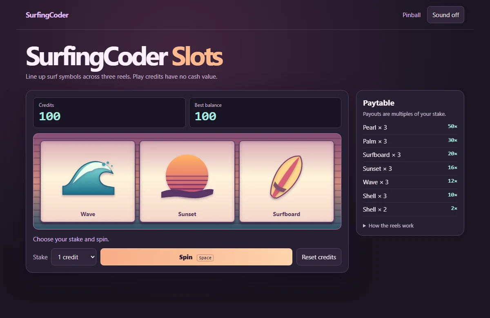

# SurfingCoder Slots

Spin three reels of illustrated surf symbols with play credits. [Play on SurfingCoder](https://surfingcoder.com/slots/).

Choose a stake of 1, 5, or 10 credits, then click **Spin** or press **Space**. Three matching symbols pay the amount listed on the paytable. Two shells pay 2×. The game saves your balance and personal best in the browser. **Reset credits** restores the balance to 100 and keeps your best.

Each reel draws independently from the weights shown under **How the reels work**. Credits have no cash value.

To run locally, use `python -m http.server 8000 --bind 127.0.0.1` from the repository directory, then visit [localhost:8000](http://127.0.0.1:8000/). The app uses Canvas and Web Audio. Run `node --test rules.test.mjs` to verify the scoring rules.
